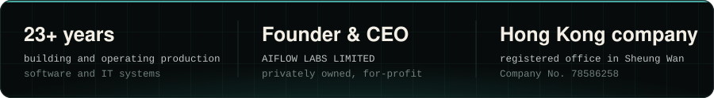

<a href="https://github.com/AIFlow-Labs-Limited"><picture><source media="(prefers-color-scheme: dark)" srcset="assets/header-dark.svg"><source media="(prefers-color-scheme: light)" srcset="assets/header-light.svg"></picture></a>

## What I build

Each product follows the same loop: inspect, approve, repair, verify, report. The AI does the work, a named person approves it, and the customer keeps the record.

<a href="https://github.com/AIFlow-Labs-Limited/ironward"><picture><source media="(prefers-color-scheme: dark)" srcset="assets/card-ironward-dark.svg"><source media="(prefers-color-scheme: light)" srcset="assets/card-ironward-light.svg"></picture></a>

<a href="https://github.com/AIFlow-Labs-Limited/ironward-web"><picture><source media="(prefers-color-scheme: dark)" srcset="assets/card-ironward-web-dark.svg"><source media="(prefers-color-scheme: light)" srcset="assets/card-ironward-web-light.svg"></picture></a>&nbsp;<a href="https://github.com/AIFlow-Labs-Limited/ironward-web3"><picture><source media="(prefers-color-scheme: dark)" srcset="assets/card-ironward-web3-dark.svg"><source media="(prefers-color-scheme: light)" srcset="assets/card-ironward-web3-light.svg"></picture></a>

<a href="https://github.com/AIFlow-Labs-Limited/rewire"><picture><source media="(prefers-color-scheme: dark)" srcset="assets/card-rewire-dark.svg"><source media="(prefers-color-scheme: light)" srcset="assets/card-rewire-light.svg"></picture></a>&nbsp;<a href="https://github.com/AIFlow-Labs-Limited/impera"><picture><source media="(prefers-color-scheme: dark)" srcset="assets/card-impera-dark.svg"><source media="(prefers-color-scheme: light)" srcset="assets/card-impera-light.svg"></picture></a>

Product sites: [ironward.aiflowlabs.io](https://ironward.aiflowlabs.io) &nbsp;·&nbsp; [rewire.aiflowlabs.io](https://rewire.aiflowlabs.io) &nbsp;·&nbsp; [impera.aiflowlabs.io](https://impera.aiflowlabs.io)

## Background

<picture><source media="(prefers-color-scheme: dark)" srcset="assets/strip-dark.svg"><source media="(prefers-color-scheme: light)" srcset="assets/strip-light.svg"></picture>

## Contact

[ilessio@aiflowlabs.io](mailto:ilessio@aiflowlabs.io) &nbsp;·&nbsp; [aiflowlabs.io](https://aiflowlabs.io) &nbsp;·&nbsp; [LinkedIn](https://www.linkedin.com/in/aiflowml) &nbsp;·&nbsp; [X @AIFlow_ML](https://x.com/AIFlow_ML) &nbsp;·&nbsp; [AIFLOW LABS on GitHub](https://github.com/AIFlow-Labs-Limited)
